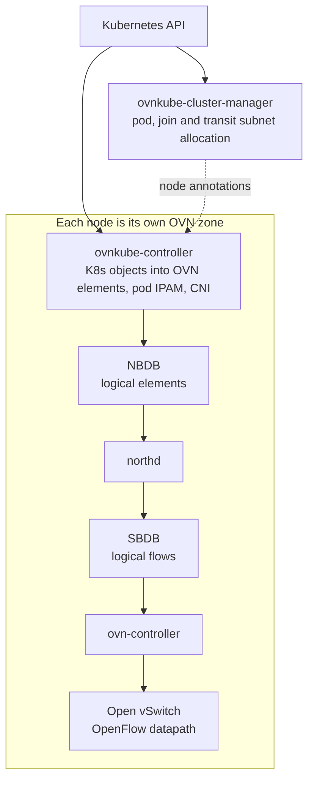

# ovn-kubernetes: A robust Kubernetes networking platform

[![Build][build-badge]][build-url]
[![License][apache2-badge]][apache2-url]

[build-badge]: https://github.com/dsx-ai-factory/ovn-kubernetes/actions/workflows/build.yml/badge.svg
[build-url]: https://github.com/dsx-ai-factory/ovn-kubernetes/actions/workflows/build.yml
[apache2-badge]: https://img.shields.io/badge/License-Apache%202.0-blue.svg
[apache2-url]: https://opensource.org/licenses/Apache-2.0
[upstream]: https://github.com/ovn-kubernetes/ovn-kubernetes

> [!IMPORTANT]
> **This repository is a read-only snapshot.** It publishes a point-in-time
> source release of [OVN-Kubernetes][upstream], packaged and modified by NVIDIA
> for NVIDIA Cloud Partners (NCPs) and independent software vendors (ISVs)
> building networking on NVIDIA infrastructure.
>
> **No external contributions are accepted here.** A pull request opened against
> this repository cannot be merged and will be closed.
>
> - To **contribute a change**, send it to the [upstream project][upstream].
> - To **report a problem** with this snapshot, open an
>   [issue](https://github.com/dsx-ai-factory/ovn-kubernetes/issues/new/choose).
> - To **report a security vulnerability**, follow [SECURITY.md](SECURITY.md).
>   Never use a public issue or pull request.

## Welcome to ovn-kubernetes

OVN-Kubernetes (Open Virtual Networking - Kubernetes) is an open-source project
that provides a robust networking solution for Kubernetes clusters with
OVN (Open Virtual Networking) and Open vSwitch (Open Virtual Switch) at its core.
It is a Kubernetes networking conformant plugin written according to the
CNI (Container Network Interface) specifications.

This repository carries NVIDIA's distribution of that project: the upstream code
plus NVIDIA modifications, cut at a released point in time and published so that
partners can read, audit, build, and vendor exactly what ships. See
[NOTICE](NOTICE) for the relationship to the upstream baseline.

### What this repository is not

- **Not the upstream project.** Upstream lives at
  [ovn-kubernetes/ovn-kubernetes][upstream], where the community develops,
  reviews, and releases OVN-Kubernetes.
- **Not where development happens.** Code review, CI, and release engineering
  for this distribution run on NVIDIA infrastructure. This repository receives
  the result, not the process that produced it.
- **Not a vendor-neutral build.** It is built and validated for NVIDIA
  networking hardware and the partner platforms built on it. If you want a
  general-purpose OVN-Kubernetes, build from upstream.

## Capabilities

OVN-Kubernetes implements the Kubernetes network model, plus a large set of
extensions, on top of OVN and Open vSwitch:

- **Pod networking and IPAM** — pod-to-pod connectivity over OVN logical
  switches and routers, address management, and multi-homing for pods attached
  to several networks.
- **Services** — Kubernetes Services as OVN load balancers, backed by
  EndpointSlices for scalable endpoint tracking.
- **Network security** — NetworkPolicy, cluster-scoped AdminNetworkPolicy
  (ANP and BANP), and multicast control through IGMP snooping and relay.
- **Egress control** — EgressIP, EgressFirewall, EgressService, EgressQoS, and
  egress through multiple gateway nodes.
- **Network segmentation** — User Defined Networks (UDN) for tenant isolation,
  and Cluster Network Connect for controlled traffic between isolated UDNs.
- **Routing** — BGP route advertisement and peering, EVPN, and a no-overlay
  mode that routes pod traffic over BGP-learned routes without encapsulation.
- **Hardware offload** — OVS datapath offload to SmartNICs and DPUs.
- **Quality of service** — NetworkQoS DSCP marking and traffic shaping.
- **Virtualization and mixed clusters** — KubeVirt VM live migration with
  persistent IPs, and hybrid overlay for mixed Windows and Linux clusters.

## How it works

OVN-Kubernetes watches the Kubernetes API and translates cluster objects —
nodes, pods, services, EndpointSlices, network policies and its own CRDs —
into OVN logical elements. OVN compiles those elements into logical flows,
`ovn-controller` turns the flows into OpenFlow rules, and Open vSwitch carries
the packets. Nothing in the datapath parses Kubernetes objects; by the time a
packet moves, the policy has already been compiled into flows.

That translation runs in *interconnect* mode, where every node is its own OVN
zone with its own databases. There is no cluster-wide database to scale or to
lose, and no RAFT cluster to keep in quorum. Only subnet and IP allocation
remains central; zones exchange traffic over Geneve tunnels.



How traffic leaves the cluster depends on the gateway mode. *Shared* keeps
egress inside the OVS datapath, which is what makes it offloadable to a
SmartNIC or DPU; *local* hands egress to the host network stack instead.
Shared is the default.

[Architecture of ovn-kubernetes](docs/design/architecture.md) covers the pods
and containers, the interconnect design, and the control- and data-plane
topology in full.

## Quickstart

### A local cluster with KIND

Prerequisites: Docker,
[KIND](https://github.com/kubernetes-sigs/kind#installation-and-usage),
`kubectl`, Helm v3, Go 1.23 or newer, Python 3 with `pipx`, `jq`, `openssl`
and `openvswitch`.

```bash
# Build the OVN-Kubernetes node image from this tree
make image

# Bring up a KIND cluster running it
export KUBECONFIG="${HOME}/ovn.conf"
cd contrib && ./kind.sh
```

`make help` lists the other top-level targets — `build`, `test`, `lint` and
`clean` — each of which forwards to the component Makefile that owns it.

### An existing cluster with Helm

The cluster must have **no CNI installed** and **kube-proxy disabled** —
OVN-Kubernetes provides both. `k8sAPIServer`, `podNetwork`, and
`global.imageRepositoryPrefix` have no defaults, so substitute your own API
endpoint, pod CIDR, and registry path for the placeholders below. The registry
path must contain the component images and tags pinned in the chart's
`values.yaml`.

```bash
cd charts/ovn-kubernetes
helm upgrade --install ovn-kubernetes . \
  -n ovn-kubernetes --create-namespace \
  --set k8sAPIServer=https://10.0.0.1:6443 \
  --set podNetwork=10.192.0.0/16/26 \
  --set global.imageRepositoryPrefix=registry.example.com/sdn
```

`podNetwork` carries two masks: the cluster-wide pod CIDR, and the per-node
subnet carved out of it. If the CoreDNS Service cannot be looked up, also set
`global.corednsClusterIP` to its cluster IP. See
[README-deployment.md](charts/ovn-kubernetes/README-deployment.md) for every
configurable value.

## Documentation

Here are some links to help in your ovn-kubernetes journey:

- [Welcome to ovn-kubernetes](docs/index.md) for overview of ovn-kubernetes.
- [Architecture of ovn-kubernetes](docs/design/architecture.md)
- [Deploying OVN-Kubernetes cluster using KIND](docs/installation/launching-ovn-kubernetes-on-kind.md)
- [Deploying OVN-Kubernetes CNI using Helm](docs/installation/launching-ovn-kubernetes-with-helm.md)
- [Building and installing OVN-Kubernetes](BUILD.md)
- [Contributing to OVN-Kubernetes](CONTRIBUTING.md) for how to contribute
  upstream, and why this repository takes no contributions of its own
- [Code of Conduct](CODE_OF_CONDUCT.md) for the standards expected of everyone
  taking part in the upstream community

## Versions and releases

**NVIDIA versions this distribution independently of the upstream project.** A
release number here does not correspond to an upstream release number, and an
upstream release carrying the same number may not exist at all. Do not infer
which upstream code a snapshot contains from its version — read [NOTICE](NOTICE)
and the release notes for that snapshot instead.

Three numbers in this tree increment independently:

| Number | Where it lives | What it tracks |
|---|---|---|
| Distribution release | `release-*` branches and `v*` tags | this snapshot of the source tree |
| Helm chart version | `version` in `charts/*/Chart.yaml` | the chart packaging |
| Container image version | `appVersion` in `charts/*/Chart.yaml`, dated `YYYY-MM.N` | the image build |

Pin a tag rather than a branch: a tag names one exact tree, while `release-*`
branches keep receiving security backports after the initial drop.

### Building against the Go code

`go-controller` declares the same module path as upstream,
`github.com/ovn-kubernetes/ovn-kubernetes/go-controller`, so `go get` against
this repository's URL fails with a module path mismatch. There is no module
published under this repository's own path. Vendor the tree, or add a `replace`
directive pointing at your checkout:

```text
replace github.com/ovn-kubernetes/ovn-kubernetes/go-controller => /path/to/this/checkout/go-controller
```

## License

Everything is distributed under the terms of the
[Apache License, version 2.0](LICENSE). [NOTICE](NOTICE) records the upstream
origin of this code and the fact that NVIDIA has modified it.
See [LICENSES/README.md](LICENSES/README.md) for how third-party license files
are determined for this repository.


## Who uses OVN-Kubernetes?

See [Adopters](ADOPTERS.md) for the list as of this snapshot. To add your
organization or project, open a pull request against the
[upstream project][upstream]; this repository does not take pull requests, and
the list here is refreshed from upstream with each snapshot.
