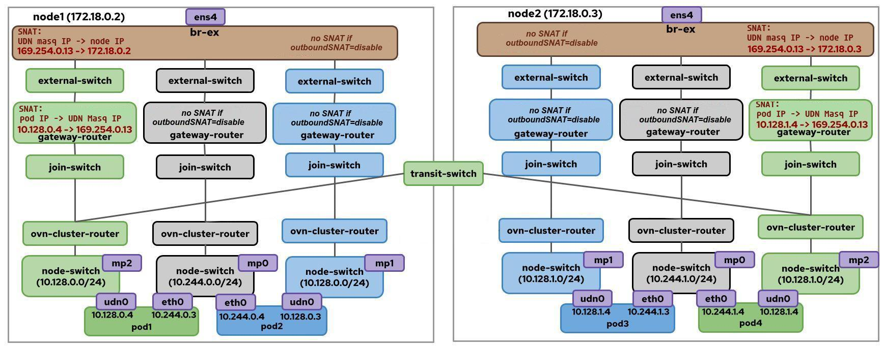

# No-Overlay Mode

## Introduction

No-overlay mode lets selected OVN-Kubernetes Layer 3 pod networks use direct
underlay routing for inter-node pod east/west traffic instead of Geneve
encapsulation. It uses the [Route Advertisements](route-advertisements.md)
integration with FRR-k8s to advertise pod network routes through BGP, so the
provider network or an OVN-Kubernetes managed internal BGP fabric can route
traffic between pod subnets.

No-overlay mode can be enabled for:

* The cluster default network.
* Primary Layer 3 `ClusterUserDefinedNetwork` (CUDN) networks.

Overlay and no-overlay networks can exist in the same cluster. Networks that do
not explicitly enable no-overlay continue to use the default OVN overlay
transport. No-overlay mode is compatible with local gateway mode and shared
gateway mode.



## Prerequisites

* A bare-metal deployment.
* OVN-Kubernetes single-node zone interconnect mode.
* The `route-advertisements` feature enabled in the OVN-Kubernetes
  configuration.
* [FRR-k8s](https://github.com/metallb/frr-k8s) deployed with FRR speakers
  running on every node.
* For unmanaged routing, administrator-created `RouteAdvertisements` and
  `FRRConfiguration` resources that exchange pod subnet routes. In managed
  routing mode, OVN-Kubernetes creates these resources for the internal
  full-mesh BGP fabric.

Always check the dependencies on the [Requirements page](../requirements.md).

> [!NOTE]
> Changing the cluster default network between overlay and no-overlay transport
> is not supported after the cluster has been created. Configure the desired
> transport at installation time.

## Motivation

The default OVN-Kubernetes overlay carries inter-node pod traffic through Geneve
tunnels. That model works without requiring the provider network to know pod
routes, but it adds encapsulation overhead and consumes CPU for tunnel handling.

No-overlay mode is useful when the deployment already has routing infrastructure
that can carry pod subnet routes. In that environment, pod traffic can use the
provider network directly, which can reduce overhead and make pod IP reachability
visible to existing network devices.

## Routing Modes

No-overlay networks use one of two routing modes.

* `managed`: OVN-Kubernetes creates the BGP resources for an internal full-mesh
  fabric. In this mode, each node advertises pod subnets to the default VRF on
  the other nodes. Use this only when nodes are directly connected at Layer 2.
  It is normally paired with SNAT enabled.
* `unmanaged`: The cluster administrator creates the `FRRConfiguration` and
  `RouteAdvertisements` resources. This is the right choice when an external
  BGP route reflector, eBGP topology, VRF-Lite design, or another site-specific
  routing design owns pod subnet distribution. This mode is normally used with
  SNAT disabled.

Managed routing currently supports only the `full-mesh` topology. For large
clusters, prefer unmanaged routing with route reflectors or another scalable BGP
topology.

In managed routing mode, administrators can still advertise the no-overlay pod
network to external BGP infrastructure by creating additional
`RouteAdvertisements` and `FRRConfiguration` resources.

## Traffic Behavior

When no-overlay mode is enabled for a network:

* Intra-node traffic remains on the local OVN bridge.
* Inter-node traffic follows the same path as north-south traffic and is routed
  through the underlay.
* Pod-to-pod and pod-to-ClusterIP traffic within the same network is forwarded
  without overlay encapsulation and without NAT.
* Pod-to-node egress traffic is SNATed to the source node IP so pods can access
  NodePort services in a different user-defined network.

## SNAT Behavior

No-overlay mode separates pod-to-pod routing from pod egress behavior.

* `outbound-snat = enabled` for the default network, or
  `outboundSNAT: Enabled` for a CUDN, SNATs pod-to-external traffic to the node
  IP. This is useful when pod IPs should not be visible or routable outside the
  cluster.
* `outbound-snat = disabled` for the default network, or
  `outboundSNAT: Disabled` for a CUDN, preserves pod IPs for external traffic.
  Use this only when the external network can route return traffic to pod IPs.

Pod-to-remote-pod traffic on a no-overlay network is not SNATed.
Traffic to remote nodes, to the Kubernetes API server, and to DNS is always SNATed.

### DC-wide SNAT exemptions

No-overlay deployments can use additional destination subnets that must
preserve source pod or VM addresses. LaunchLayer supplies these subnets in VMaaS
deployments. These exemptions apply to the default network and primary Layer 3
CUDNs with no-overlay transport and outbound SNAT enabled. Routing and isolation remain fabric responsibilities.

An external service or administrator creates and updates the following ConfigMap
in the controller's Kubernetes cluster, in the configured OVN namespace
(`ovn-kubernetes` by default, controlled by `ovn-config-namespace`). For DPU
deployments, LaunchLayer creates it in the **DPU-host Kubernetes cluster**:

```yaml
apiVersion: v1
kind: ConfigMap
metadata:
  name: dc-wide-overlay-subnets-config
  namespace: ovn-kubernetes
data:
  dc-wide-overlay-subnets: "10.10.0.0/16,20.20.0.0/16,fd00:10::/48"
```

The chart disables this integration by default. Enable it using the flag below.
This flag is independent of `global.enableNoOverlay`, which controls only the
default network transport. Leave `global.enableNoOverlay=false` when the default
network uses overlay and only UDNs need no-overlay exemptions. Configure each
UDN's transport and outbound SNAT on its UDN or CUDN resource.

For VMaaS DPU deployments, enable the feature in both releases: the DPU release
enables the watch, and the host release installs the admission policy:

```yaml
global:
  enableDCWideOverlaySNATExemptions: true
  dcWideOverlaySubnetWriters:
    - system:serviceaccount:<launchlayer-namespace>:<launchlayer-service-account>
```

The chart does not create the ConfigMap. Changes to this ConfigMap are applied
automatically. Existing OVN node RBAC already grants ConfigMap read/watch
access; this feature adds no read Role or binding.
The namespace `global.namespace` must match the controller's `ovn-config-namespace`.

A ValidatingAdmissionPolicy and binding protect creation, updates (including
patches), and deletion (including collection deletion) of this ConfigMap. They
are rendered when this feature is enabled in the standard or DPU-host release
and at least one writer allowlist is nonempty, regardless of the default network
transport. A namespace selector bounds policy evaluation to the OVN namespace,
and an object-name condition selects only this ConfigMap. Reads and other
ConfigMaps are unaffected. The policy and binding use the fixed name
`dc-wide-overlay-subnets-writers`, following existing chart conventions.
Add LaunchLayer's authenticated Kubernetes username to
`global.dcWideOverlaySubnetWriters`. The list defaults to empty; the chart does
not create LaunchLayer's service account or grant it write permissions.
Allowed writers still need ordinary RBAC permissions.

Both writer allowlists default to empty. Leave both empty to omit the admission
policy and binding in a trusted cluster; ordinary Kubernetes RBAC still controls
ConfigMap access. To enable admission protection, configure LaunchLayer's username
or approved administrator usernames or groups in deployment-specific Helm values.
When the policy is installed, ClusterRole membership alone does not bypass it.

Deletion-only exceptions allow the namespace controller to clean a terminating
namespace and the garbage collector to remove an owner-referenced ConfigMap.
They apply to the standard `kube-system` controller service accounts and the
shared `system:kube-controller-manager` identity. These exceptions grant no
permission to create or update subnet values.

Admission protection uses the v1 ValidatingAdmissionPolicy API, following the
chart's existing admission-policy templates.

For example, save the configuration above in `dc-wide-overlay-values.yaml`,
replace the service-account placeholders, and apply it after the deployment's
existing profile:

```sh
helm upgrade --install ovn-kubernetes ./charts/ovn-kubernetes \
  --namespace ovn-kubernetes \
  -f deployment-values.yaml -f dc-wide-overlay-values.yaml
```

Helm merges these files with the chart defaults; later files override earlier
values, and lists are replaced. For DPU deployments, apply the writer allowlists
to the DPU-host release, which owns the admission policy.

For deployments outside Helm, grant equivalent permissions and configure:

```ini
[no-overlay]
enable-dc-wide-overlay-snat-exemptions = true
```

The watcher can start before any eligible no-overlay networks exist. Overlay
networks ignore the published CIDRs; newly created no-overlay networks use the
current list during initialization. The flag is therefore valid even when the
default network transport is unset.

Set the Helm flag to `false` to disable the watch. DPU-host node processes do not
run the watcher; the DPU controller watches their API server.

One controller per ovnkube-controller process maintains a shared Go CIDR list.
Initial data is loaded before network controllers start. Each network merges
those CIDRs with its own subnets and local node IPs in its existing
`exempted_ext_ips` address set.
The SNAT rule's `match` and priority remain unchanged.

ConfigMap changes queue registered network names without waiting for their
handler locks. A bounded worker pool processes independent network keys
concurrently. Each queued update looks up the current handler under its lifecycle lock, checks
eligibility, and calls its base-controller reconcile method to update only its
exemption address set.
Failed OVN writes retry independently through the shared work queue.
CIDRs are normalized and deduplicated, and each network uses only its enabled
address families. Newly created networks read the current list during their
initial reconciliation.

An absent ConfigMap or key means an empty extra CIDR list, allowing startup
before LaunchLayer creates it. Deletion, removal of the key, or an empty value
removes only the DC-wide exemptions. Recreating the ConfigMap restores them.
Malformed values are logged as errors without retrying unchanged invalid input.
At startup, no extra exemptions are used until a valid value is available. Malformed runtime updates retain the last valid
list and leave exemption sets unchanged; a later valid value is applied
automatically. API/watch failures retain current state while client-go reconnects
and relists. Changes do not wait for kubelet volume projection or a polling
interval; API delivery and OVN reconciliation still take time.

### Kind e2e coverage

The Kind helper defaults the feature flag to `ENABLE_NO_OVERLAY`. Set
`ENABLE_DC_WIDE_OVERLAY_SNAT_EXEMPTIONS=true` explicitly when the default network
uses overlay and no-overlay UDNs need exemptions. Whenever the feature is
enabled, the helper loads `contrib/kind-dc-wide-overlay-snat-values.yaml` to allow
its e2e administrator groups (`system:masters` and `kubeadm:cluster-admins`).
Extra values files passed to the helper override those Kind-specific defaults.
Set `ENABLE_DC_WIDE_OVERLAY_SNAT_EXEMPTIONS=false` to disable the feature
explicitly; the Helm chart default remains `false`, with both writer allowlists
empty.

The normal sequential no-overlay control-plane run includes the four cases
labelled `Feature:DCWideOverlaySNATExemptions` when the feature is enabled.
The netseg invocation excludes the feature label to avoid duplicating network
lifecycle coverage.
The startup and CUDN lifecycle cases are explicitly Kind-only: they restart the
node-local controller and inspect its colocated NBDB. Other providers skip
these cases; the traffic and admission case has no Kind-only provider guard.

For local iteration, select these cases by their shared description text. Run
from the repository root with the no-overlay cluster and external BGP fixture
already configured:

```bash
cd test
ENABLE_NO_OVERLAY=true ENABLE_ROUTE_ADVERTISEMENTS=true \
ENABLE_NETWORK_SEGMENTATION=true ADVERTISE_DEFAULT_NETWORK=true PARALLEL=false \
E2E_CP_DOWNSTREAM_HOOK=./scripts/e2e-cp-nvidia-overrides.sh \
  ./scripts/e2e-cp.sh "DC-wide SNAT exemptions"
```

These cases use the normal suite timeout and report, with no separate pass or
guaranteed position in the run. They share a cluster-wide ConfigMap and restart
controllers; cleanup removes the test exemptions and waits for normal SNAT
before subsequent specs execute. The runner checks feature configuration and
writer access even when invoked from a fresh shell after cluster creation.

The `Feature:NoOverlay` e2e cases use an external echo server to check
source addresses on the default network and primary Layer 3 CUDNs:

- ConfigMap creation, valid and malformed updates, deletion, recreation and clearing.
- Controller startup with malformed or absent ConfigMap data, followed by valid
  updates.
- CUDN creation before and after controller restart with an unchanged valid
  ConfigMap.
- Multi-network updates, deletion during an update, same-name recreation, and
  absence of orphan exemption sets after later updates.

Admission coverage impersonates a temporary namespace writer and verifies that
create, update, patch, delete and collection-delete requests are rejected while
reads and creation of unrelated ConfigMaps succeed. Rejected writes use dry-run
to avoid changing dataplane state if admission protection regresses. A copy of
the deployed policy in an isolated namespace also verifies actual garbage
collection and namespace termination without deleting the OVN namespace.
CUDN subnets come from the shared BGP test allocator.

These cases require the no-overlay lane with shared gateway mode, outbound SNAT,
default-network advertisement and the BGP external-server fixture. Startup and
network lifecycle checks require the standard Kind deployment with a controller
and NBDB on the workload node; unsupported layouts skip those lifecycle checks.
The Kind helper and companion CI configuration default
`ENABLE_DC_WIDE_OVERLAY_SNAT_EXEMPTIONS` to `ENABLE_NO_OVERLAY` and configure
writer groups when the feature is enabled. An explicit `true` tells the tests to
fail if feature configuration or writer authorization is missing. Set it to
`false` to skip these cases. When the flag is unset, tests skip if configuration
or writer access is unavailable, or an externally managed exemptions ConfigMap
already exists.

## Enable no-overlay mode on the Default Network

The default network is configured with the `transport` option in the `[default]`
section and no-overlay options in the `[no-overlay]` section of the
OVN-Kubernetes configuration file.

### Managed Routing

Use managed routing when OVN-Kubernetes should create the internal BGP fabric
for the default network.

```ini
[default]
transport = no-overlay

[no-overlay]
outbound-snat = enabled
routing = managed

[bgp-managed]
topology = full-mesh
as-number = 64512
frr-namespace = frr-k8s-system
```

With this configuration, OVN-Kubernetes creates:

* A managed `RouteAdvertisements` object for the default network.
* A managed base `FRRConfiguration` in the configured FRR namespace.

The managed `FRRConfiguration` peers node FRR speakers with each other and
allows them to receive the no-overlay pod subnet routes.

The shared base template lists the nodes' Kubernetes `InternalIP` addresses as
BGP neighbors. When generating an individual node's `FRRConfiguration`,
OVN-Kubernetes removes that node's own InternalIPs from the neighbor list. This
prevents self-peering: a node attempting to establish a BGP session with itself.
Filtering uses the same address source as the template, rather than the
`k8s.ovn.org/node-primary-ifaddr` annotation, which may be absent or contain
different addresses.

If a selected node has no InternalIP, generation stops for the entire
`RouteAdvertisements` resource. Existing FRR configurations remain in place,
but configuration updates for the other selected nodes also wait. The
controller retries with backoff up to 15 times after the initial attempt;
this limit is an internal controller setting, not a user-configurable option.
The RA status remains unchanged during these retries. If they are exhausted,
the controller attempts to report `Accepted=False` with reason `InternalError`
and stops automatic error retries. Existing FRR configurations are still
preserved.

A subsequent node address update triggers reconciliation again, even after
the retry limit has been reached. Once the required InternalIPs are available,
successful reconciliation updates the configurations and reports
`Accepted=True`. No controller restart is needed. User-provided templates do
not require InternalIPs or receive this automatic neighbor filtering; see the
[Route Advertisements workflow](route-advertisements.md#workflow-description).

When deploying with the OVN-Kubernetes Helm chart, the equivalent global values
are:

```yaml
global:
  enableRouteAdvertisements: true
  enableNoOverlay: true
  enableNoOverlaySnat: true
  enableNoOverlayManagedRouting: true
  managedBGPTopology: full-mesh
  managedBGPASNumber: 64512
  managedBGPFRRNamespace: frr-k8s-system
```

### Unmanaged Routing

Use unmanaged routing when the administrator owns the BGP configuration.

```ini
[default]
transport = no-overlay

[no-overlay]
outbound-snat = disabled
routing = unmanaged
```

In unmanaged mode, create an `FRRConfiguration` that peers with the routing
infrastructure and accepts pod subnet routes. The values below are examples;
adjust the AS numbers, neighbor address, and pod subnet prefixes for your
deployment.

```yaml
apiVersion: frrk8s.metallb.io/v1beta1
kind: FRRConfiguration
metadata:
  name: default-no-overlay
  namespace: frr-k8s-system
  labels:
    network: default-no-overlay
spec:
  nodeSelector: {}
  bgp:
    routers:
    - asn: 64512
      neighbors:
      - address: 172.20.0.2
        asn: 64512
        disableMP: true
        toReceive:
          allowed:
            mode: filtered
            prefixes:
            - prefix: 10.128.0.0/16
              ge: 24
              le: 24
```

Then create a `RouteAdvertisements` object that selects the default network and
the `FRRConfiguration`:

```yaml
apiVersion: k8s.ovn.org/v1
kind: RouteAdvertisements
metadata:
  name: default-no-overlay
spec:
  advertisements:
  - PodNetwork
  nodeSelector: {}
  frrConfigurationSelector:
    matchLabels:
      network: default-no-overlay
  networkSelectors:
  - networkSelectionType: DefaultNetwork
```

The default network no-overlay controller validates that at least one
`RouteAdvertisements` object advertises the default network pod routes and has
`Accepted=True`. If none exists, or if the selected object is not accepted,
OVN-Kubernetes reports an event on the default network
`NetworkAttachmentDefinition`.

## Enable no-overlay mode on a ClusterUserDefinedNetwork

No-overlay CUDNs are configured in the `ClusterUserDefinedNetwork` API. Only
primary Layer 3 CUDNs are supported.

```yaml
apiVersion: k8s.ovn.org/v1
kind: ClusterUserDefinedNetwork
metadata:
  name: blue
  labels:
    network: blue
spec:
  namespaceSelector:
    matchExpressions:
    - key: kubernetes.io/metadata.name
      operator: In
      values:
      - blue-a
      - blue-b
  network:
    topology: Layer3
    layer3:
      role: Primary
      mtu: 1500
      subnets:
      - cidr: 10.10.0.0/16
        hostSubnet: 24
    transport: NoOverlay
    noOverlay:
      outboundSNAT: Disabled
      routing: Unmanaged
```

The `noOverlay` field is required when `transport: NoOverlay` is set and is
forbidden otherwise. The `ClusterUserDefinedNetwork` API also rejects
no-overlay transport on Layer 2, localnet, and secondary Layer 3 networks.
The CUDN `spec` is immutable, so the transport configuration cannot be changed
after the CUDN is created.

To use managed routing for a CUDN, set `routing: Managed` and configure the
global `[bgp-managed]` section shown in the default network managed-routing
example. The CUDN still reports transport acceptance only after a
`RouteAdvertisements` object advertises its pod routes and reaches
`Accepted=True`.

Create a `RouteAdvertisements` object that selects the CUDN and advertises
`PodNetwork` routes:

```yaml
apiVersion: k8s.ovn.org/v1
kind: RouteAdvertisements
metadata:
  name: blue-no-overlay
spec:
  advertisements:
  - PodNetwork
  nodeSelector: {}
  frrConfigurationSelector:
    matchLabels:
      network: blue
  networkSelectors:
  - networkSelectionType: ClusterUserDefinedNetworks
    clusterUserDefinedNetworkSelector:
      networkSelector:
        matchLabels:
          network: blue
```

For VRF-Lite designs, set `targetVRF: auto` or a specific VRF as described in
the [Route Advertisements VRF-Lite workflow](route-advertisements.md#import-and-export-routes-to-a-cudn-over-the-network-vrf-vrf-lite).

When the CUDN is reconciled, OVN-Kubernetes sets the `TransportAccepted` status
condition:

```yaml
status:
  conditions:
  - type: TransportAccepted
    status: "True"
    reason: NoOverlayTransportAccepted
    message: "Transport has been configured as 'no-overlay'."
```

If no accepted `RouteAdvertisements` object advertises the CUDN pod routes, the
condition is set to `False` with a reason such as
`NoOverlayRouteAdvertisementsIsMissing` or
`NoOverlayRouteAdvertisementsNotAccepted`.

## Operational Notes

* The MTU for a no-overlay pod network can match the provider network MTU
  because there is no Geneve overhead. Do not set a pod MTU larger than the
  underlay can carry.
* `RouteAdvertisements` with `PodNetwork` must select all nodes with
  `nodeSelector: {}`. A network cannot be partly overlay and partly no-overlay.
* No-overlay CUDNs with overlapping pod subnets cannot be advertised into the
  same VRF. Use a VRF-Lite design when overlapping pod CIDRs are required.
* East-west traffic depends on the BGP network. BGP speaker outages can impact
  cluster pod networking.
* No-overlay mode inherits the limitations of the Route Advertisements and BGP
  integration.
* Network debugging includes both OVN-Kubernetes and the BGP routing
  infrastructure. Check the `RouteAdvertisements` status before debugging data
  plane paths.

## Known Limitations

* No-overlay mode is limited to the cluster default network and primary Layer 3
  CUDNs.
* `UserDefinedNetwork`, Layer 2 CUDN, localnet CUDN, and secondary Layer 3 CUDN
  no-overlay transport are not supported.
* Creating a no-overlay network manually with a `NetworkAttachmentDefinition` is
  not supported.
* No-overlay mode does not rely on routes that administrators might add directly to
  the underlay. Each no-overlay network must have at least one accepted
  `RouteAdvertisements` object that advertises `PodNetwork` routes. In unmanaged
  routing mode, administrators must create the matching `RouteAdvertisements`
  and `FRRConfiguration` resources. In managed routing mode, OVN-Kubernetes
  creates those resources for the internal BGP fabric.
* Features that rely on OVN delivering pod-to-pod traffic through the overlay,
  such as IPsec, multicast, EgressIP, and EgressService, are not supported on
  no-overlay networks.
  OVN-Kubernetes does not reject EgressIP or EgressService configuration on a
  no-overlay network, so do not rely on those features for no-overlay traffic.
* Advertised UDN isolation loose mode is broken if multiple no-overlay UDNs are
  advertised to the same VRF. Use VRF-Lite or an external routing design that
  preserves the intended isolation.
* Managed routing uses a full-mesh BGP topology and is not intended for large
  clusters.
* The default network transport cannot be changed between overlay and
  no-overlay after cluster creation.

## Related Documentation

* [Route Advertisements](route-advertisements.md)
* [User Defined Networks](../user-defined-networks/user-defined-networks.md)
* [No-overlay enhancement proposal](../../okeps/okep-5259-no-overlay.md)
* [UserDefinedNetwork API reference](../../api-reference/userdefinednetwork-api-spec.md)
